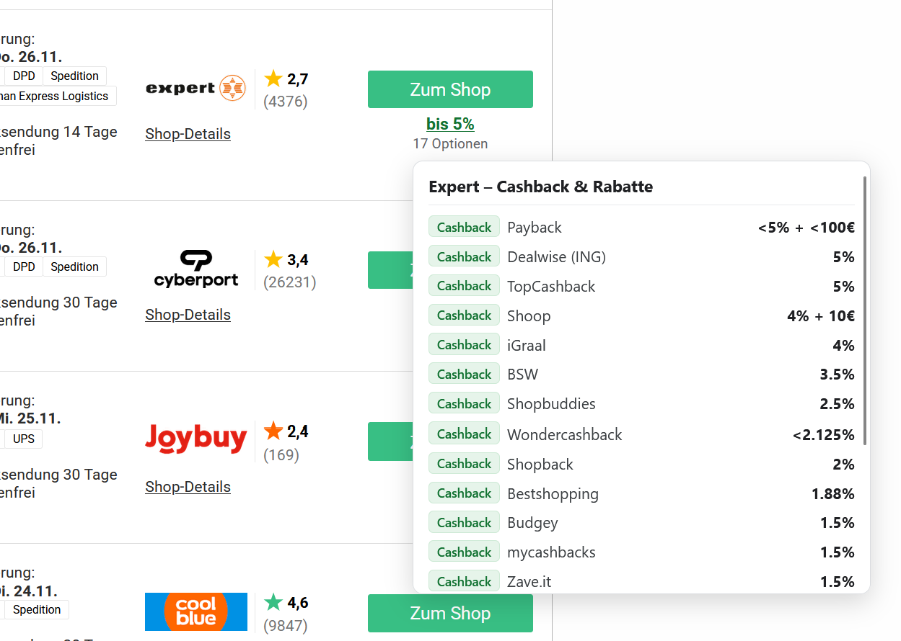

# Cashback Optimizer für Preisvergleiche (Chrome & Firefox)

Zeigt Cashback-, Rabatt- und Gutscheinmöglichkeiten von [cashback-optimizer.de](https://cashback-optimizer.de/) direkt bei den Angeboten auf Idealo, Geizhals (`geizhals.de`, `geizhals.at`, `gh.de`), billiger.de und guenstiger.de an.

## Installation

### Google Chrome / Edge / Brave
1. Die aktuelle `.zip` unter **Releases** herunterladen und entpacken.
2. `chrome://extensions/` öffnen und oben rechts den **Entwicklermodus** aktivieren.
3. Auf **Entpackte Erweiterung laden** klicken und den entpackten Ordner auswählen.

### Mozilla Firefox (ab Version 109+)
* **Signierte Version (empfohlen):** Die `.xpi`-Datei aus **Releases** herunterladen und direkt in Firefox installieren.
* **Entwicklermodus (temporär):** `about:debugging#/runtime/this-firefox` öffnen → **Temporäres Add-on laden…** → `manifest.json` auswählen.

---

## Datenquelle & Unterstützung
Alle Cashback-, Rabatt- und Gutscheindaten stammen von [Cashback Optimizer](https://cashback-optimizer.de/).  
Wenn dir diese Erweiterung beim Sparen geholfen hat, unterstütze den Betreiber von [https://cashback-optimizer.de/](https://cashback-optimizer.de/) gerne mit einer kleinen Spende.
